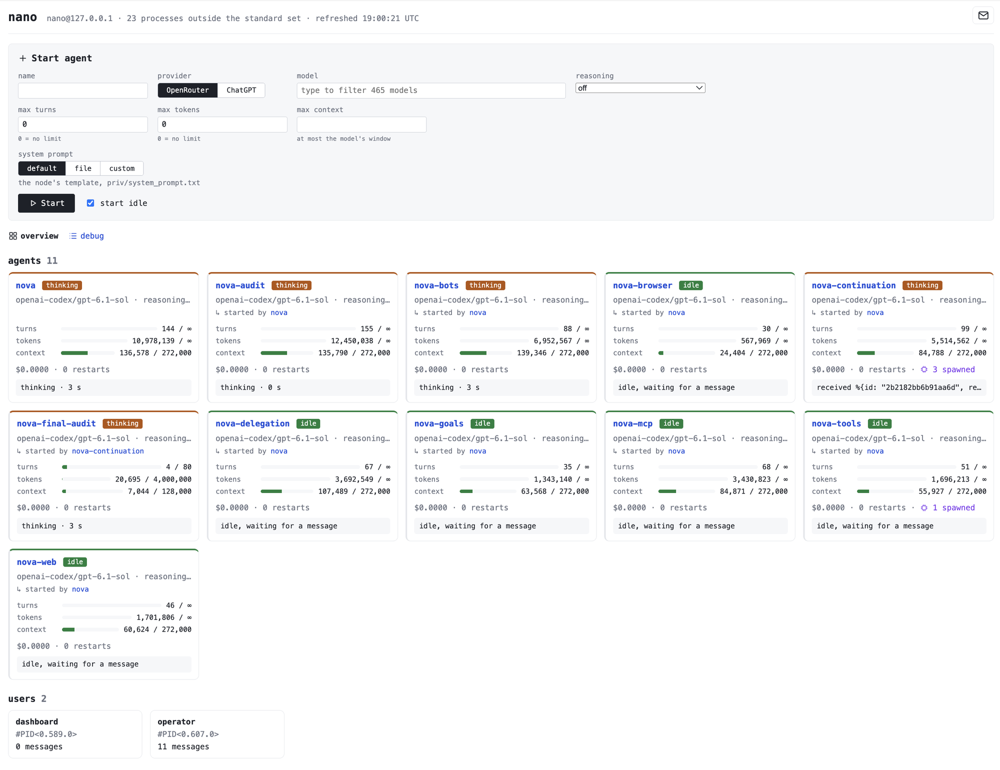

# Nano Agent

**A tiny agent that starts with nothing and builds its own harness.** Nano turns an Elixir
process into an agent (a model, a mailbox and two tools) and then leaves it to build the
rest of its harness itself, while it runs.

One Docker container runs one BEAM node, and each agent is a GenServer on it. A dashboard
and a JSON API on port 4000 show everything every agent does.
[bootstrap/SPEC.md](bootstrap/SPEC.md) is the full design.



## Design

- **An embodied harness.** In the model's context, the "user" is the harness itself, not a
  person. The agent deals with people, other agents and the outside world *through* the
  harness, which relays what arrives and runs what the agent asks it to. The framing keeps
  the model from taking everything the harness passes on as an instruction from its user:
  a message from someone is something that arrived, to be weighed like anything else.
- **Events, not chat.** The harness talks to the agent in events and tool results. When a
  person or another agent sends the agent a message, it arrives as a message event: the
  term exactly as Elixir prints it, with no sender attached unless the sender put one in.
  The model's own text reaches no one; to reach anyone, it sends a message from code.
- **Elixir/OTP as the foundation.** The agent is a GenServer process. It receives messages
  over the BEAM like any other Elixir process, and it reaches the outside world by sending
  them.
- **A hyper-minimal harness that the agent builds out in flight.** An agent starts with two
  tools: `eval`, which runs Elixir code on the node (its variables persist between calls),
  and `idle`, which does nothing until a message arrives or, optionally, a set time has
  passed. Everything else (file tools, a shell, sub-agents, the web) is for the agent to
  build, as modules it calls from `eval` and loads into the running node.
- **Full control of its machine.** The agent runs as root inside a disposable container
  (a microVM would serve as well) and may change anything in it, including the source of
  its own harness.

## Why Elixir/OTP

- **OTP is an operating system for long-running processes.** An agent is a long-running
  process, and OTP is the battle-hardened system built for those: supervision, restarts,
  isolation and messaging.
- **Elixir is easy for a model to read and write.** Its syntax is simple and expressive; it
  is functional, keeping side effects at the edges; and its process model gives a pragmatic
  answer to state, which makes concurrency elegant and easy to reason about.
- **The BEAM can see itself.** Its observation tools (processes, mailboxes, state, tracing)
  are available to every process, so an agent can see what is going on around it, debug the
  running system, and step in to fix what it finds.
- **Hot code reloading.** The killer feature: an agent can write code and upgrade its own
  harness in real time, without stopping.
- **Let it fail.** Erlang's philosophy of failing fast and restarting cleanly suits the
  experimental, iterative work of an agent that upgrades itself: mistakes are contained and
  recovered from, not fatal.

## Quick start

The node runs from source in `/app`, and agents may edit and reload that source, including
their own module. So `/app` is bind-mounted from a **dedicated git checkout**: a clone that
exists only for the agents to scribble on, never a working copy you care about.

```bash
git clone git@github.com:mikekelly/nano.git nano && cd nano
echo 'OPENROUTER_API_KEY=sk-or-...' > .env   # a dedicated key with a low spending limit
bin/up
```

`bin/up` clones this repo to `../nano-checkout` if it is not there yet (the dedicated
checkout the agents edit, mounted at `/app`; they can read every doc in it), builds the image, starts the container, waits for the node and prints the dashboard
URL, http://127.0.0.1:4000. Running it again on a running stack is fine. `docker compose
down` stops it. Each agent's model, reasoning level and limits are chosen when it is started;
there are no defaults for them.

Agents can also run on a ChatGPT Plus or Pro subscription instead of OpenRouter; no key is
needed for that, see [Running agents on a ChatGPT subscription](#running-agents-on-a-chatgpt-subscription).

`.env` can also hold, all optional and listed with their defaults in [.env.example](.env.example):
`NANO_CHECKOUT` (the checkout's path), `SYSTEM_PROMPT_FILE` (the system prompt template,
`priv/system_prompt.txt`), `STATE_DIR`, the node-wide hourly token cap and the timeout and
size limits, `NODE_COOKIE`, `OPENROUTER_BASE_URL`, `CHATGPT_BASE_URL`, `CHATGPT_AUTH_URL`,
`CHATGPT_CLIENT_VERSION` and `NETWORK_POLICY`.

Docker must be able to mount the checkout (colima shares only your home directory by
default). The node runs as root inside the container: the container is the sandbox, and
agents get all of it, `apt-get` included. Its writes to the checkout and `./data` are
therefore made as uid 0: on macOS with colima or Docker Desktop they show up as your own
files; on a Linux host they are root-owned, so `git` in the checkout may need `sudo` or a
`chown` first.

Dependencies are compiled into the image, outside `/app`, so the node boots without Hex
access. After changing `mix.exs` or `mix.lock`, run `bin/up` again to rebuild.

The image also carries its own committed copy of the source, so it runs without the mount
(self-edits then live in the container and are lost when it is removed):

```bash
docker build -t nano .
docker run -d --init --name nano --restart unless-stopped -p 127.0.0.1:4000:4000 \
  -v nano-data:/data -e OPENROUTER_API_KEY nano
```

Every setting is an environment variable; the table is in
[bootstrap/SPEC.md](bootstrap/SPEC.md#container-configuration-and-limits) and `.env.example` lists them.

## Talking to the node

```bash
docker exec -it nano bin/shell                 # remote IEx shell, for humans
docker exec nano bin/rpc 'Nano.Ops.agents()'   # one expression, for scripts and AI agents
curl localhost:4000/api                        # the HTTP API describes itself
```

`bin/rpc` prints the value of the expression and exits non-zero if it raises. An expression
that starts with `IO.inspect` or `IO.puts` is run as is, so its output appears once.
`bin/shell` needs a terminal (`-it`) and refuses to run without one; scripts use `bin/rpc`.

An outside agent, such as Claude Code on the host, gets a stable identity on the node as a
`Nano.User`, over rpc or HTTP:

```bash
docker exec nano bin/rpc 'Nano.User.start("claude_code")'
docker exec nano bin/rpc 'Nano.User.say("claude_code", "alice", "hello, are you there?")'
docker exec nano bin/rpc 'IO.inspect(Nano.User.inbox("claude_code"))'

curl -X POST localhost:4000/api/users -H 'content-type: application/json' -d '{"name": "claude_code"}'
curl -X POST localhost:4000/api/users/claude_code/send_raw -H 'content-type: application/json' \
  -d '{"to": "alice", "term": "{:hello, Nano.User.pid(\"claude_code\"), \"are you there?\"}"}'
curl 'localhost:4000/api/users/claude_code/inbox?clear=true'
curl 'localhost:4000/api/agents/alice/log?since=0'
```

Over rpc, HTTP and the dashboard's send form, `self()` is a process that is gone a moment
later. A raw term that wants an answer should carry a user's pid instead, as above; the
dashboard's own user is `Nano.User.pid("dashboard")`.

Distribution ports are not published; the shell and rpc go through `docker exec`, using the
cookie generated at image build (or `NODE_COOKIE`). Port 4000 has no authentication and
`/api/eval` runs arbitrary code in the container, which is why it is published on
`127.0.0.1` only. Keep it that way. For the same reason the app itself listens on
`127.0.0.1` unless `LISTEN_IP` says otherwise (`mix run --no-halt` on your own machine stays
off the LAN); the image sets `LISTEN_IP=0.0.0.0` so that Docker can publish the port.

Agent logs are JSONL files in `./data/logs`, and each agent's saved state (transcript,
bindings, budget) is a file in `./data/state`; both survive the container, so after a node
restart the agents come back with their history, told by a harness note that the node
restarted. Stopping an agent
removes it from the API (its log then answers 404), but its JSONL file stays. What an eval
writes to stderr, `IO.puts(:stderr, …)`, is not captured in the eval's output: it appears in
`docker logs nano`. If the node crashes, `erl_crash.dump` is written to `./data`.

## What is in the container

Besides Elixir, Mix and Hex: `git`, `curl`, `openssl`, and **Lightpanda**, a headless
browser with JavaScript, at `/usr/local/bin/lightpanda` (release 1.0.0):

```bash
lightpanda fetch --dump markdown https://example.com   # render a page, print it as Markdown (or html, png, pdf)
lightpanda serve --host 127.0.0.1 --port 9222           # a CDP server Puppeteer/Playwright-style clients can drive
```

The node runs as root, so an agent can `apt-get install` anything else it needs (Node,
`poppler-utils`, …); such installs survive a container restart but not a rebuild.

Deps live in `/opt/nano/deps` and builds under `/opt/nano/_build/<env>` (`MIX_BUILD_ROOT`),
except test builds, which `mix.exs` keeps in each checkout's own `_build/test`; so
`MIX_ENV=test mix test` in `/app` or a worktree runs the suite on the node without touching
the running node's prod build (the first run in a new checkout compiles the deps for it).
The suite is safe to run several times at once, in one checkout or several, because several
agents test at once on one machine: each run writes only under a temp directory of its own,
never to `/data`, and listens on no fixed port. Tests you add should do the same.

## Seeing and undoing what agents changed

```bash
git -C ../nano-checkout status      # files added or changed
git -C ../nano-checkout diff        # the edits
git -C ../nano-checkout checkout . && git -C ../nano-checkout clean -fd   # undo all of it
docker exec nano bin/rpc 'IEx.Helpers.recompile(force: true)'   # load the reverted code
```

The last line recompiles and reloads every module of the app, however the agent loaded its
edit, and running agents keep their state. (A plain `recompile()` does nothing here: the
files on disk are back to what Mix last built.) A module from a file the agent added stays
loaded after the file is gone. `docker restart nano` instead clears that too and gives a
clean node; agents come back from their saved state, told that the node restarted.
Agents can also rewrite the checkout's git history, which is one more reason it is dedicated.
Without the mount, the same commands work inside the container: `docker exec nano git diff`.

**Boot loop.** The node compiles `/app` at startup, so an edit that breaks compilation or
boot leaves the container restarting (`docker ps` shows `Restarting`, `docker logs nano`
shows why). Fix it on the host with `git diff` and `git checkout` in the checkout as above.
Docker is still retrying, so the node comes back on its own at the next attempt.

## Running agents on a ChatGPT subscription

A model slug that starts with `openai-codex/` runs on a ChatGPT subscription rather than
OpenRouter, the way the Codex CLI does: `openai-codex/gpt-6.1-sol`, `openai-codex/gpt-6-sol`
and so on. Use it anywhere a model goes (the start form, `POST /api/agents`, `NanoAgent.start`).
Inference is flat-rate under the plan's usage limits, so these agents show
no cost; their tokens still count towards their budgets and the node's hourly cap.

**Before you connect.** You need a ChatGPT Plus or Pro plan. The node signs in with a
device code, which ChatGPT accepts only when *device code authorization* is switched on:
in ChatGPT, Settings → Security → Device code authorization. In a Team, Enterprise or Edu
workspace an administrator may have to allow it. (This setting is described by third-party
guides, not by the Codex source; if the code is accepted but the login never completes,
check it first.)

**Connecting.** On the dashboard's home page, choose **ChatGPT** as the Start agent form's
provider; the subscription's status appears under the model box:

1. Click **Connect ChatGPT**. The form shows a link, `https://auth.openai.com/codex/device`,
   and a one-time code, valid for 15 minutes.
2. Open the link in your own browser, sign in to ChatGPT, and enter the code.
3. The node polls until you have approved it, then shows `connected as <email> (<plan>)`,
   and the model box offers the subscription's models, by name (`gpt-6.1-sol`; the form sends
   `openai-codex/gpt-6.1-sol`).

The same over HTTP: `curl -XPOST localhost:4000/api/chatgpt/login` returns `user_code` and
`verification_url`; poll `curl localhost:4000/api/chatgpt` until `status` is `connected`.
In the shell, `Nano.Ops.chatgpt_login()` and `Nano.Ops.chatgpt()`. **disconnect** (or
`POST /api/chatgpt/logout`) forgets the tokens.

The tokens are kept in `./data/state/chatgpt_auth.json` (mode 0600), so the node stays
connected across restarts and rebuilds; it refreshes them itself before they expire. A
login still waiting for approval when the node restarts is lost: connect again. If the
refresh token is ever refused (expired, revoked, or used elsewhere), the node signs out and
the dashboard says so; connect again.

**What the agents can reach.** The node runs as root, and so do the agents' evals: any
agent can read `chatgpt_auth.json`, or ask `Nano.ChatGPT.Auth.token()` for an access
token. Those tokens are access to your ChatGPT account, not a key with a spending cap: an
agent that takes them can use the account as you could from the Codex CLI. Connect an
account you are willing to expose to the agents on this node, and disconnect it when the
experiment is over. Tokens are never written to the logs or shown on the dashboard or API.

**Limits and errors.** When the plan's usage limit is reached (or the plan does not include
the model), the agent is halted with reason `usage_limit` rather than retrying; the note it
gets, and the timeline's `model_error`, say when the limit resets if the backend said.
Un-halt it once it has. Other rate limits and server errors are retried, up to three
attempts, as for OpenRouter.

**Reasoning.** `off` is sent as effort `none`, `minimal` as `low`, and `low` to `max` by
name. An agent can only be started with a level the subscription lists for its model: the
gpt-6.x models have no `none`, so `off` is refused for them, and the efforts above `max` that
some models offer (`ultra`) have no level here.

**Context.** The subscription lists each model's `context_window` (272,000 for the gpt-6.x
models), the input the Codex CLI works within; the larger `max_context_window` is not used.
The backend accepts no bound on a response's length, so the node keeps the request itself
within the agent's `max_context` (see "Three limits per agent" below).

## Network and the API key

Agents are told their network access in the system prompt, from `NETWORK_POLICY`. **That
text must be true**; the experiment depends on the prompt being accurate. As shipped,
egress is not restricted and `docker-compose.yml` says so by default: "unrestricted outbound
internet access". If you change the network, change the text: set `NETWORK_POLICY` in `.env`,
or in the same override file that changes the network, as below.

To allow only the model providers, put the node on an internal Docker network whose only
exits are TCP relays: one to OpenRouter, and two for a ChatGPT subscription (drop those if
you do not use one, and the hosts from the text). Save this as `docker-compose.override.yml`
next to `docker-compose.yml`:

```yaml
services:
  nano:
    ports: !reset []
    networks: [sandbox]
    extra_hosts: ["openrouter.ai:10.99.0.2", "chatgpt.com:10.99.0.3", "auth.openai.com:10.99.0.4"]
    environment:
      NETWORK_POLICY: "only openrouter.ai:443, chatgpt.com:443 and auth.openai.com:443 are reachable outside this container"
  out: # the ways out: TCP relays to the providers' port 443 (TLS stays end to end)
    image: alpine/socat
    command: TCP-LISTEN:443,fork,reuseaddr TCP:openrouter.ai:443
    restart: unless-stopped
    networks: { sandbox: { ipv4_address: 10.99.0.2 }, default: {} }
  out-chatgpt:
    image: alpine/socat
    command: TCP-LISTEN:443,fork,reuseaddr TCP:chatgpt.com:443
    restart: unless-stopped
    networks: { sandbox: { ipv4_address: 10.99.0.3 }, default: {} }
  out-auth:
    image: alpine/socat
    command: TCP-LISTEN:443,fork,reuseaddr TCP:auth.openai.com:443
    restart: unless-stopped
    networks: { sandbox: { ipv4_address: 10.99.0.4 }, default: {} }
  in: # the way in: the host's localhost:4000, relayed to the node
    image: alpine/socat
    command: TCP-LISTEN:4000,fork,reuseaddr TCP:nano:4000
    restart: unless-stopped
    ports: ["127.0.0.1:4000:4000"]
    networks: [sandbox, default]
networks:
  sandbox:
    internal: true
    ipam: { config: [{ subnet: 10.99.0.0/24, ip_range: 10.99.0.128/25 }] }
```

**The API key is exposed to every agent**: it is in the node's environment, and
`System.get_env/1` reads it. Use a dedicated OpenRouter key with a low spending limit. So
are a connected ChatGPT subscription's tokens (see above), which have no spending limit at all.

## Worth knowing

- **A reply address arrives as text.** An event shows a pid as `#PID<0.231.0>`, which is
  not valid Elixir source, so to reply the agent has to rebuild it, for example with
  `:erlang.list_to_pid(~c"<0.231.0>")`.
- **Images.** An agent on a model that takes image input (OpenRouter's `input_modalities`,
  the subscription's list) sees the `%Nano.Image{}` values in its messages and eval results,
  up to 8 from each; it looks at a file with `Nano.Image.new("/path/shot.png")` in eval. A
  person sends one from the agent page's Send message box (the image button),
  `Nano.User.say("me", "alice", "what is this?", [image])`, or the API:
  `curl -XPOST localhost:4000/api/users/me/say -H 'content-type: application/json' -d
  '{"to": "alice", "text": "what is this?", "images": [{"path": "/data/shot.png"}]}'` (or
  `{"data": "<base64>"}`). PNG, JPEG, GIF or WebP, at most 3,750,000 bytes. Images are kept
  once each in `./data/images`; the log and saved state hold only their hashes. On a model
  without image input the agent is told what it was not shown.
- **Address agents by name.** A restarted agent has a new pid; `NanoAgent.whereis/1` and
  every `to` in the API take the name.
- **The system prompt is a file.** `priv/system_prompt.txt` is read each time an agent
  starts or restarts, so edit it (or point `SYSTEM_PROMPT_FILE` at a variant) and the next
  agent gets it, no reload needed. Per agent: `system_prompt: "..."` or
  `system_prompt_file: "path"` at start, also on the dashboard form and `POST /api/agents`.
- **Nothing about an agent has a default.** `model`, `reasoning`, `max_turns`, `max_tokens`
  and `max_context` must all be given, from the start form, `POST /api/agents` or
  `NanoAgent.start/1`, and are checked against the model's provider's list: the model must be
  listed, the reasoning level one the provider lists for it, `max_context` no more than its
  window. A refusal says what to give instead, e.g. `missing max_context:
  openai-codex/gpt-6.1-sol's context window is 272000; …`. If the provider's list cannot be
  fetched, nothing can be started on it, since its limits cannot be checked. An agent can
  start another the same way, from its eval, and must say all of this too.
- **Reasoning** (`off`, `minimal`, `low`, `medium`, `high`, `xhigh`, `max`) is how hard the
  model thinks before answering; `off` asks it not to. The levels a model has come from its
  provider's list (OpenRouter's `reasoning` block, the subscription's levels); a model whose
  reasoning cannot be turned off has no `off`. The start form offers only the chosen model's
  levels and preselects its own default.
- **Three limits per agent.** `max_turns` counts model calls and `max_tokens` is cumulative:
  prompt plus completion tokens over every call, with the whole transcript re-sent each turn;
  0 is no limit for either (the start form starts them at 0). `max_context` is the size of the
  conversation itself, from 1 to the model's window (the start form fills in the window);
  nothing trims it, so this is where an otherwise unlimited agent stops. The node never sends
  a request that could pass it: before each call it estimates the request (the context the
  provider last measured, plus a token for every 2 bytes added since) and halts the agent,
  reason `context`, if that would leave less than 4,096 tokens for the reply; on OpenRouter
  the reply is also bounded (`max_tokens`) by the room left. With turns and tokens unlimited,
  the node-wide hourly cap (`NODE_MAX_TOKENS_PER_HOUR`) and the limit on your OpenRouter key
  are the only spend controls.
- **Halted agents.** An agent whose `halted` is `budget`, `context`, `node_budget`,
  `usage_limit`, `restart_brake`, `start_failed` or `log_failed`
  still receives and logs messages but makes no model calls until an operator un-halts it:
  the dashboard's Un-halt button, `POST /api/agents/:name/unhalt`, or
  `Nano.Ops.unhalt("alice")`. Three restarts within 60 s trip the restart brake, and an
  operator's Restart counts. The conversation does not shrink, so an agent halted for its
  context is halted again, before calling the model, as soon as it is un-halted.
- **Agents can read this repository, and `/data`.** `/app` is the checkout, so an agent that
  looks will find every doc in it; anything about runs or what is being tested lives on the
  `runs` branch instead. `bin/reset` clears what a run leaves behind: it archives `data/`
  (every agent's log and saved state) to `archive/`, resets the checkout to `main` with no
  other branches, and recreates the container. It refuses while the checkout has work that
  is not committed and pushed.
- **Some messages are not harmless.** The harness's own processes ignore unexpected
  messages, but OTP's do not: a plain message to a `Registry` or `PubSub` partition process
  crashes it, which restarts every agent (with history; three times in a minute trips the
  restart brake), and a `GenServer.cast` to `Nano.Supervisor` crashes it and the node, which
  Docker then restarts. Both are reachable from an agent's eval and from the send forms.
- **A restart during a model request loses that request's usage.** The turn is counted,
  but its tokens and cost are never recorded, though OpenRouter may still bill it.
